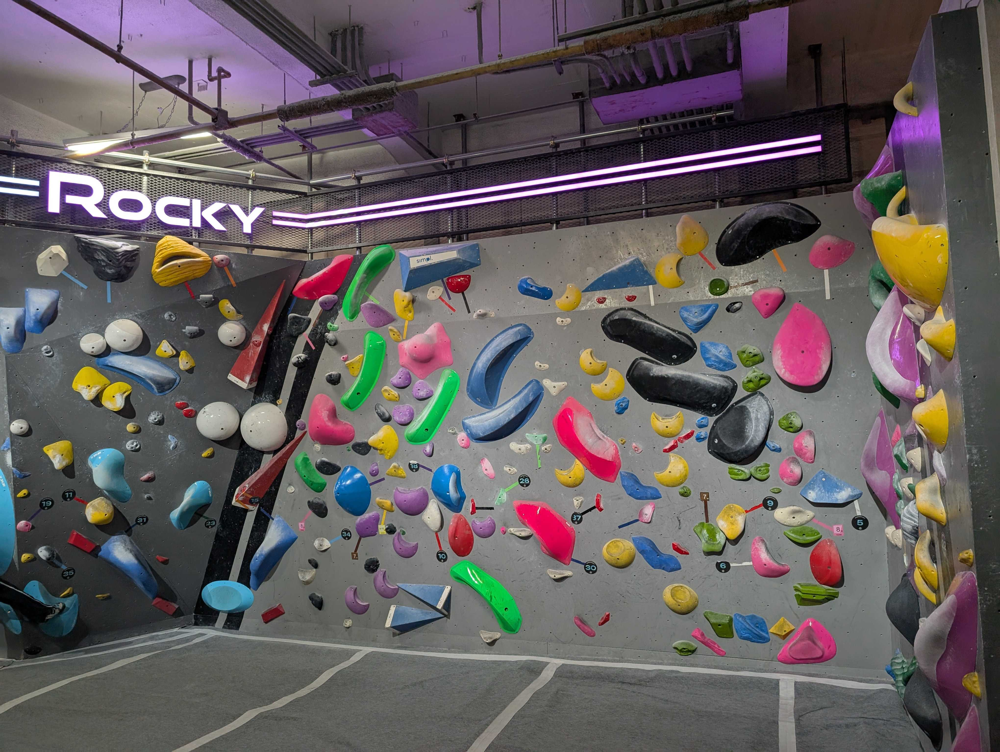
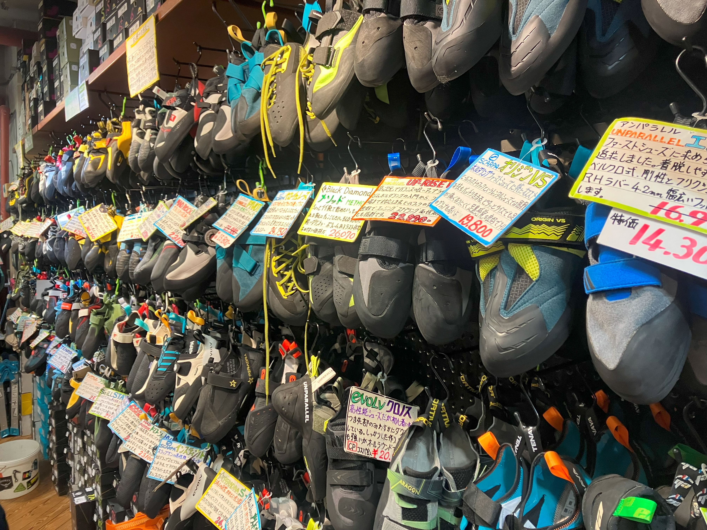
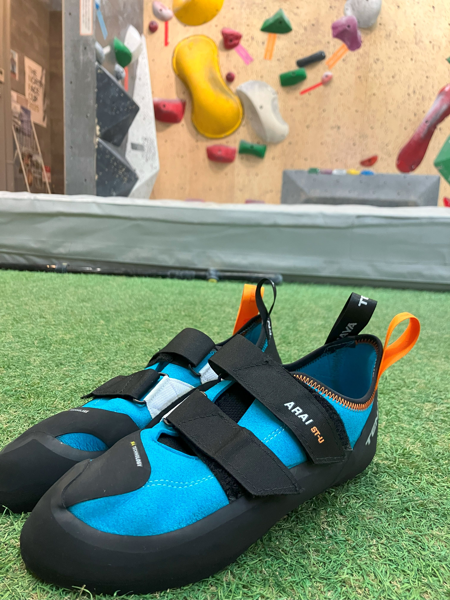

<!-- _class: lead -->

# 🧗‍♂️:athletic_shoe:

---

<!-- _class: lead -->

# ボルダリングシューズを買ってよかった話

---

## わいです

* yokuda
* ボルダリング歴: 気持ちは半年ほど
  * はじめて登ったのは7年前
  * 月1になったのは、去年12月
  * 週1になったのは、今年4月

---

## ボルダリングとは

* ロープなしで壁を登る
* 3-5mの低い壁
* パズル的なスポーツ
* **必要な装備が少ない**
  - 基本的にシューズだけでOK
  - シューズは数少ないお金を使うところ

<!-- 画像: カラフルなホールドがついたボルダリングウォール -->

---

## グレード（難易度）について

* 課題ごとに難易度が設定
* 8級（やさしい）〜初段（むずかしい）
* 色でも区別されている

<!-- 画像: グレード表示やカラフルなホールド -->

---

## なぜシューズを買ったか

* レンタルシューズの問題
  - 様々な人に使われておりすり減っている
    - グリップ力がない
  - 毎回料金がかかる

マイシューズが欲しくなった

<!-- 画像: ジムのシューズラックとレンタルシューズ -->

---

## 専門店をおすすめする理由

* 豊富な品揃え
* 専門スタッフのアドバイス
* 安心の試着

<!-- 画像: 靴の試着をしている人の写真 -->

---

## シューズ選びのポイント

* 普通の靴より小さめサイズ
* 試着は絶対必須
* つま先が少し曲がるくらい
* 一足目は履いてて痛くならないもの

<!-- 画像: ボルダリングシューズのタイトフィット感 -->

---

## 専門店での購入体験

* カラファテで購入
* スタッフがサイズ測定
* 複数ブランドを試着
* 価格: 約20,000円

納得して選べた！

<!-- 画像: クライミングショップでの購入体験 -->

---

## 使ってみた感想

* 足にフィット
* 小さなホールドも掴める
* グレードが0.5-1級向上した
* 疲労感が軽減

<!-- 画像: ボルダリングシューズでホールドを掴んでいる足 -->

---

## 買ってよかった理由

* レンタル料不要
* 上達を実感
* モチベーション向上

専門店で買ったからこその満足感

<!-- 画像: ボルダリングで達成感を味わっている人 -->

---

## これから買う人へのアドバイス

* 専門店で購入すべし
* 必ず試着
* スタッフのアドバイスを聞く

### おすすめ
* ジム併設ショップ
  * B-PUMP
* 登山用品専門店
  * カラファテ

<!-- 画像: スポーツ用品店でのアドバイスシーン -->

---

## まとめ

* 専門店で買うべき
* 試着とアドバイスが重要
* 上達とモチベーションアップ

**専門店がおすすめ！**

---

<!-- _class: lead -->

# 宣伝

## 8/23（土）15時ごろ「ゆるっとボルダリング会」開催！
〜初心者・久しぶりの方歓迎〜
（2-3時間ほどを想定）

🧗‍♂️ ぜひ参加してください！

一緒にボルダリングを楽しみましょう
