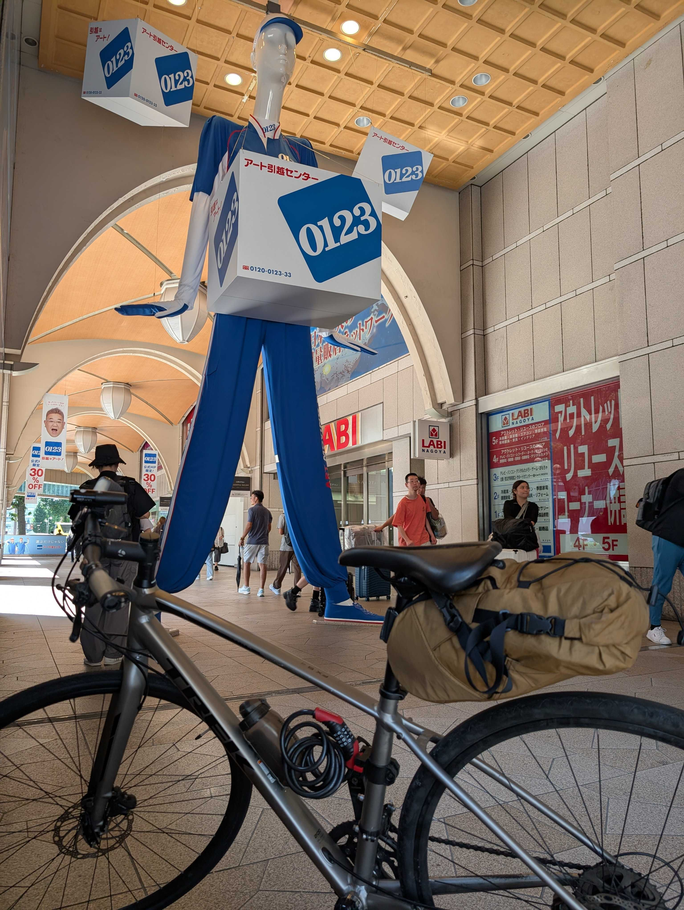
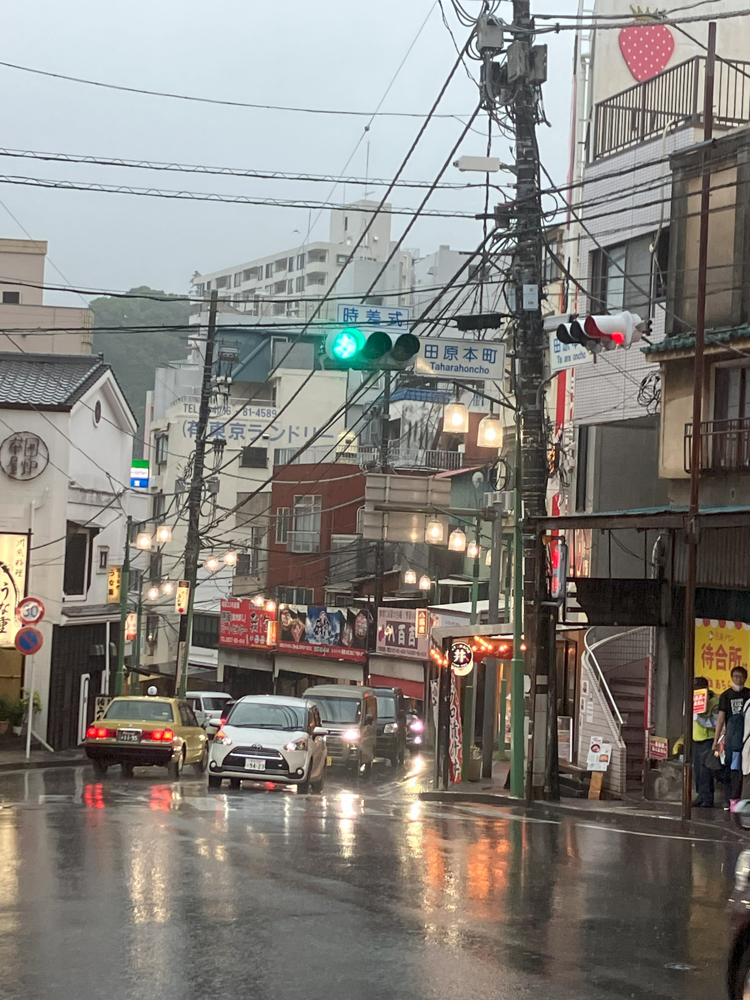
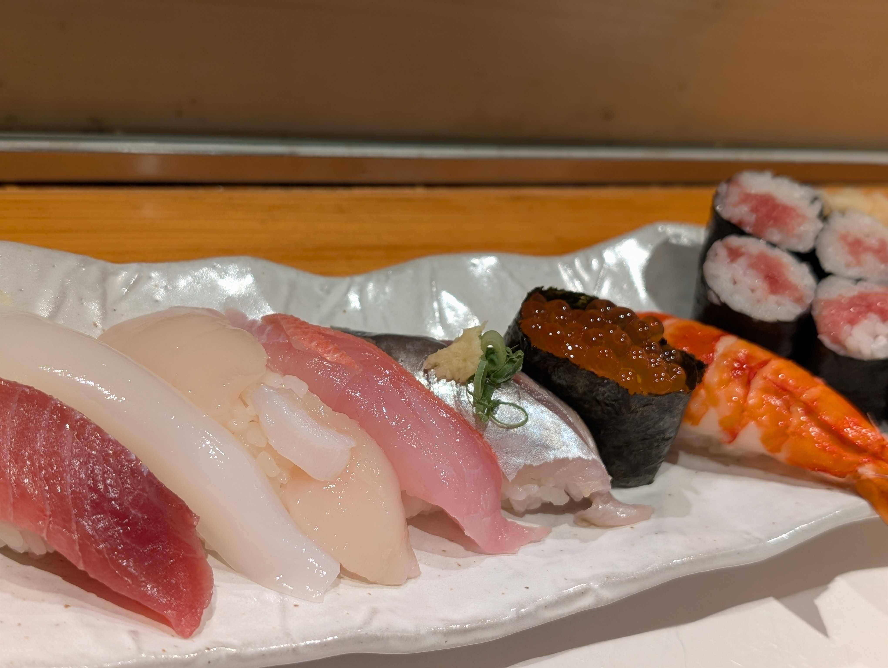
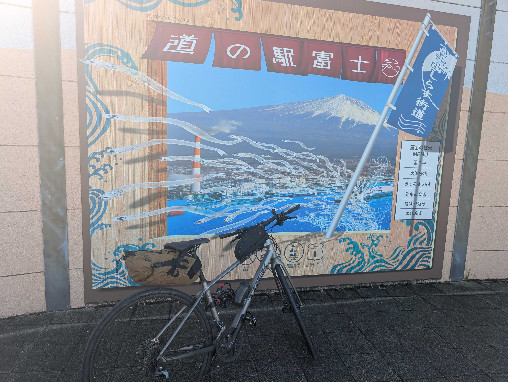
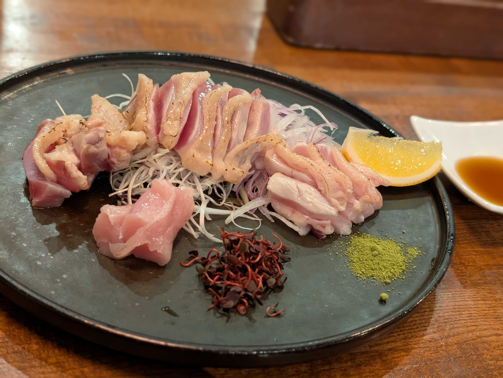
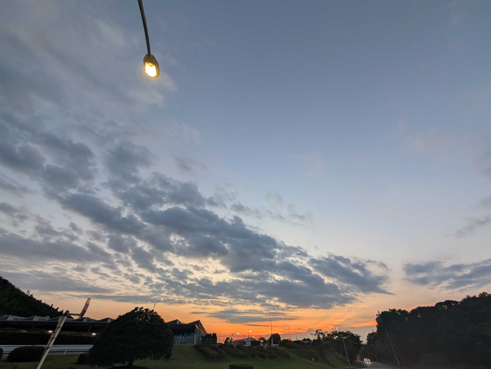
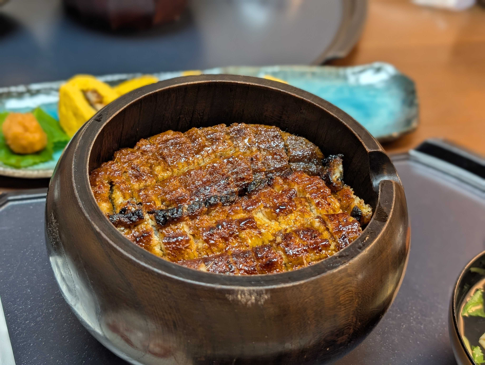
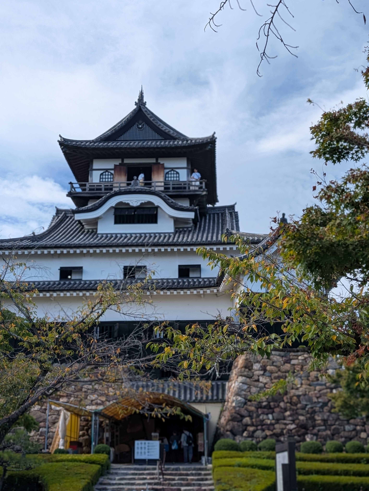
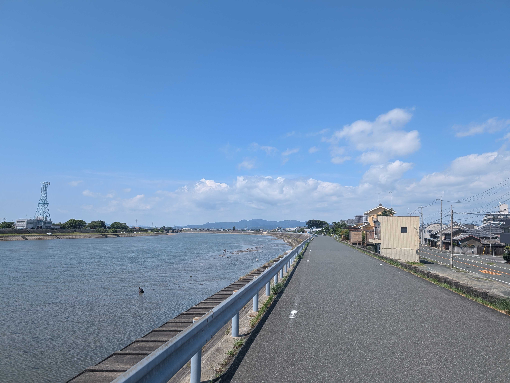
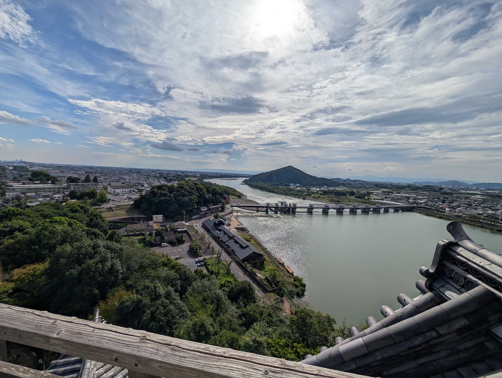

# 炎天下と親しもう
# 名古屋うなぎライド編 🚴‍♂️

---

## 事前練習：江ノ島ライド

- 江ノ島往復で炎天下に順応トレーニング
- 日差し＋路面の照り返しが想像以上に強烈
- 対策を決定：早朝スタート／正午は退避／こまめに日焼け止め
- 江ノ島後に追加：トップチューブバッグ／トレランバッグ／ソフトウォーターボトル（ソフトボトル）
- 学び：ペースは低強度重視（無理しない）、日陰休憩を計画的に
 - 江ノ島後の炎天下対策：昼は走らない／背中に氷を背負って体を冷やす

---

## 行程ざっくり

- 1日目: 新宿 → 熱海 → 沼津（台風接近で豪雨／警報）
- 2日目: 沼津 → 焼津 → 御前崎（パンク→修理、スーパー銭湯）
- 3日目: 御前崎 → 浜松・豊橋 → 蒲郡 → 安城
- 4日目: 安城 → 名古屋（街中は自転車走りにくい…）

---

## 移動距離・所要時間

- 期間: 4泊5日（移動4日）
- 1日目: 約140km / 約11時間
- 2日目: 約130km / 約12時間
- 3日目: 約120km / 約11時間
- 4日目: 約20km / 約2時間

---

---

## 目的とハイライト

- 目的
  - 最終目標「奈良→東京」に向けた距離延ばし
  - 夏休みの長期休みを活用した旅行
  - うなぎを食べる（名古屋で友だちと合流）
- ハイライト
  - 熱海～海沿い区間がとても気持ちいい（晴れなら絶景確定）
  - 浜松～豊橋は路面良くてスピード出せる

---

## 前回からの装備差分（さわやか・大洗比）

- 前回: サイクリングパンツ／サドル下バッグ
- 追加したもの：
  - ヘルメット、サイクリンググローブ、ビンディングシューズ
  - トップチューブバッグ、トレランバッグ、ソフトボトル
  - スマホマウント（トップチューブと干渉でほぼ未使用）
  - 反射ベスト（夜間安全）

---

## 長距離対策（フォーム）

- 体幹で回す（腹・背中・骨盤で支える意識）
- 上半身は脱力、肘は軽く曲げる
- 体重分散：手／尻／足の三点に配分
- 痛みが出たらポジションをこまめに微調整

---

## 1日目（0500-1700）

- 台風接近で荒天（大雨・洪水警報）
- 出発遅れ＋雨で全身びしょ濡れ
- 海沿いは快適だったが休める場所が少ない
- 箱根峠は超難所、歩き多めで突破
- 沼津で宿泊、洗濯＆寿司で補給

---

---

## 2日目（0700-1230 / 1600-1900）

- 富士山近くでパンク発覚→焼津の自転車店でタイヤ＆チューブ交換
- スーパー銭湯で英気を養う（最高）
- 夕方に再出発、道は交差多めでややストップ＆ゴー
- ライト電池切れに気づき焦る→リアのみ点灯＋スマホライト

---

---

## 3日目（0700-1100 / 1600-）

- 浜松餃子はスルー（ノリで移動続行…）
- 豊橋手前まで一気に進み休憩
- 蒲郡のホテルは満室多く断念→安城で宿確保

---

## 4日目（0700-1000）と観光

- 名古屋は自転車通行不可の道が多く走りづらい
- 到着後は街散策とうなぎ、犬山城観光

---

---

---

## 実際の所感（装備・運用）

- 防滴装備は大雨だと無力→トップチューブバッグのみ無事
- ライトは電池管理が命（予備必須）
- スマホは濡れると操作不能→補給・ナビが難しくなる

---

---

## 反省点（次回改善）

- 雨対策・夜間対策・日焼け対策を強化
- パンク対策（チューブ・タイヤ・工具・練習）
- 土産・ご当地グルメは事前計画

---

## これから走る人へ（注意）

- 天気・台風情報を確認、代替案（輪行/宿）も用意
- レインウェアは“防水”等級＆電子機器は防水袋へ
- 前後ライト＋予備電池／モバイルバッテリー必須
- パンク修理は事前練習＋予備チューブ/レバー/ポンプ
- 休憩/補給/風呂/輪行ポイントを地図にマーク
- 都市部は「自転車通行不可」多め→事前にルート確認

---

## 反面教師ポイント（今回はこうなった）

- 台風に突っ込む（真似しないで）🌧️
- ライト電池切れで冷や汗💦
- 濡れてスマホ操作不能→補給も迷子も倍つらい
- スマホマウントがバッグと干渉→ほぼ未使用
- 名物を食べ逃す（浜松餃子・さわやか…）🥟

---

## 自転車旅の楽しみどころ

- 自分の脚で到達する圧倒的達成感💪
- 景色の連続変化（海・街・夕焼け）
- ご飯が数倍うまい＆風呂が天国♨️
- 知らない街の小さな発見が多い
- 夜は爆睡できる（最高のご褒美）

---

## おわりに

- 名古屋は遠いけど達成感はでかい！
- 熱海～海沿いはまた行きたいコース
- 次は「到着してから楽しめる距離」で計画的に！

---

---

## ご清聴ありがとうございました！
# Let's 自転車旅！🚴‍♀️
